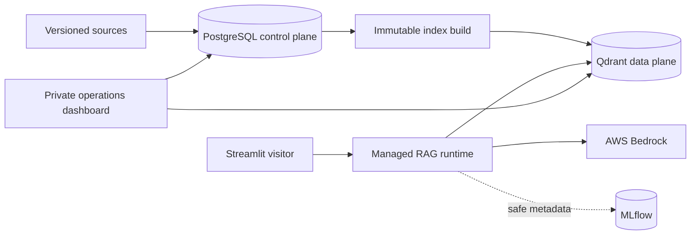
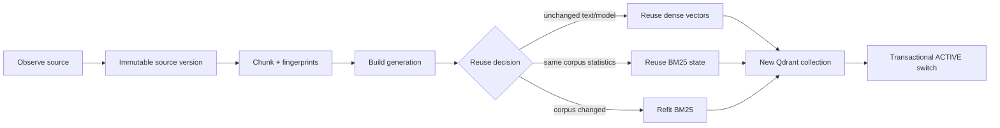
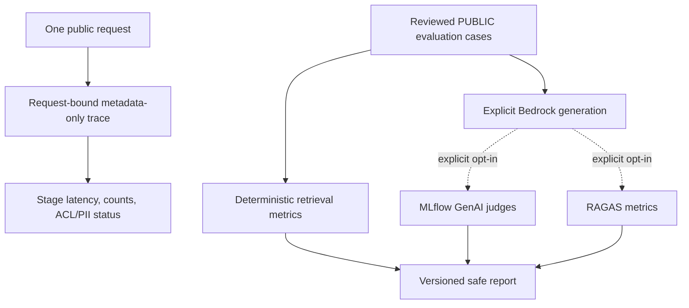
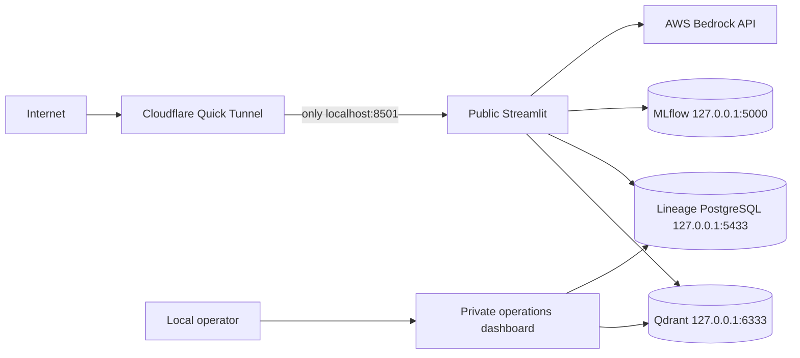

# Consumer Finance Intelligence

Consumer Finance Intelligence is a production-shaped retrieval-augmented generation platform over
public U.S. consumer-finance material. It combines immutable PostgreSQL lineage, hybrid Qdrant
retrieval, Hugging Face embeddings and reranking, AWS Bedrock generation, ACL and PII governance,
MLflow observability, deterministic quality evaluation, and a Streamlit portfolio interface.

The full platform runs locally on Windows. A temporary Cloudflare Quick Tunnel may expose only the
public Streamlit showcase; PostgreSQL, Qdrant, MLflow, and the operations dashboard stay on
loopback. The project provisions no AWS hosting infrastructure.

> Educational demonstration only. Generated answers are not legal or financial advice.

## What this demonstrates

- Stable source identity with immutable document versions and chunk derivations.
- Incremental generation builds with dense-vector reuse and corpus-wide BM25 reuse or refitting.
- Transactional publication of immutable Qdrant generations and generation-pinned retrieval.
- Dense HNSW + sparse BM25 retrieval, reciprocal rank fusion, cross-encoder reranking, and citations.
- Qdrant ACL pre-filtering plus defense-in-depth payload validation.
- Deterministic PII classification and post-rerank redaction.
- Request-level safe telemetry and request-bound MLflow trace correlation.
- Separate deterministic retrieval, generated-answer, MLflow GenAI, and RAGAS evaluation results.
- Read-only validation, cleanup planning, restoration planning, and operations views.

## Architecture

### Platform overview



### Indexing lifecycle



### Public request and governance

```mermaid
flowchart LR
    U[Anonymous visitor] --> L[Length + process-wide usage gate]
    L --> X[Redact visitor PII]
    X --> A[Empty AccessContext]
    A --> Q[Qdrant PUBLIC-only filter]
    Q --> V[Defense-in-depth ACL validation]
    V --> R[Rerank]
    R --> P[REDACT context]
    P --> B[Bedrock answer]
    B --> Z[Redact public output]
    Z --> C[Answer + clickable citations]
```



### Observability and evaluation



### Local public/private deployment



## Quick start

Prerequisites: Python 3.12, `uv`, Docker Desktop, an approved Bedrock model, and standard AWS
credentials. Copy `.env.example` to `.env`, replace both local database passwords, and configure
the Bedrock model.

```powershell
uv sync
docker compose up -d
uv run alembic upgrade head
uv run python scripts/check_environment.py --managed-smoke
```

The application never migrates, indexes, publishes, restores, cleans up, evaluates, or invokes a
judge during normal startup. On a fresh database, ingest and publish explicitly:

```powershell
uv run python scripts/ingest_incremental.py --mode fixture --authoritative-snapshot --apply
uv run python scripts/index_managed.py --publish
```

Review the dry-run output before either mutation. For an existing environment, start services and
run the preflight; do not republish automatically.

### Start the public showcase locally

The public app fails closed unless all of these settings are explicit:

```dotenv
RAG__RUNTIME__PROFILE=managed
RAG__PUBLIC_SHOWCASE__ENABLED=true
RAG__PUBLIC_SHOWCASE__INFERENCE_ENABLED=true
RAG__PUBLIC_SHOWCASE__APPROVED_CORPUS_KEY=consumer-finance-managed
BEDROCK_GENERATION_MODEL=your-enabled-bedrock-model-id
```

```powershell
uv run streamlit run app/streamlit_app.py --server.address 127.0.0.1 --server.port 8501 `
  --client.showErrorDetails none
```

To expose only that port through a temporary tunnel:

```powershell
cloudflared tunnel --url http://127.0.0.1:8501
```

See [Local public demo](docs/local-public-demo.md) for health checks, cost controls, cross-network
testing, shutdown, and private operator access.

### Private operator tools

```powershell
uv run streamlit run app/operations_dashboard.py --server.address 127.0.0.1 --server.port 8502
uv run python scripts/manage_index_generations.py --status
uv run python scripts/manage_index_generations.py --validate
uv run python scripts/manage_index_generations.py --cleanup-plan
uv run python scripts/manage_index_generations.py --restore-generation 3
```

The operations dashboard and MLflow UI must remain local. Never route ports `8502`, `5000`, `6333`,
`6334`, or `5433` through the public tunnel.

## Evaluation

Deterministic managed retrieval evaluation makes no Bedrock or judge calls:

```powershell
uv run python scripts/evaluate_managed_retrieval.py --current
uv run python scripts/evaluate_managed_rag.py --current
```

Generated answers and judges are separately opt-in and may incur AWS charges:

```powershell
uv run python scripts/evaluate_managed_rag.py --current --generate --limit 2
uv run python scripts/evaluate_managed_rag.py --current --generate --limit 2 --with-mlflow-judges
uv run python scripts/evaluate_managed_rag.py --current --generate --limit 2 --with-ragas
uv run python scripts/evaluate_managed_rag.py --current --generate --limit 2 `
  --with-mlflow-judges --with-ragas --log-mlflow
```

The managed evaluator pins ACTIVE once, accepts only reviewed synthetic PUBLIC cases, uses the
production ACL/PII pipeline, and writes a versioned metadata-only report. The public Evaluation tab
reads existing reports only; it never starts generation or judges. Phase 2 reports remain visible
separately and preserve the fixture/evaluation compatibility paths.

## Runtime profiles

| Profile | Purpose | PostgreSQL lineage | Generation identity |
|---|---|---:|---:|
| `fixture` | Small Phase 1 local corpus | No | None |
| `evaluation` | Isolated Phase 2 corpus | No | None |
| `managed` | Phase 3 immutable generations | Required | Pinned once per runtime |

Only `managed` is accepted by the public showcase. Anonymous callers cannot submit a principal,
groups, or an `ALLOW` PII policy.

## Documentation

- [Project learning guide](docs/project-learning-guide.md) — implementation walkthrough and
  interview explanations.
- [Local public demo](docs/local-public-demo.md) — Windows + Cloudflare Quick Tunnel runbook.
- [End-to-end demo](docs/end-to-end-demo.md) — ingestion, publication, retrieval, evaluation,
  validation, cleanup planning, and restoration planning.
- [System design walkthrough](docs/system-design-walkthrough.md) — engineering trade-offs and five
  change scenarios.
- [Detailed architecture](docs/architecture.md) — schemas, invariants, telemetry, and operations.
- [Phase 2 interview notes](docs/phase2-interview-notes.md) and
  [validation record](docs/phase2-validation.md).

No screenshot is committed because the repository contains no verified, portable live-service
capture. The UI renders genuine runtime and report data and intentionally shows unavailable states
instead of fabricated scores or screenshots.

## Validation

```powershell
uv sync
uv run ruff check .
uv run mypy .
uv run pytest
docker compose config --quiet
git diff --check
uv run alembic heads
```

Offline tests use fakes and do not call Bedrock, MLflow judges, or RAGAS judges. A passing offline
suite does not prove live PostgreSQL, Qdrant, MLflow, model-download, AWS credential, Bedrock, or
Cloudflare connectivity.

Never use `docker compose down -v` when preserving PostgreSQL, Qdrant, or MLflow data. A normal
`docker compose down` keeps the named volumes.
