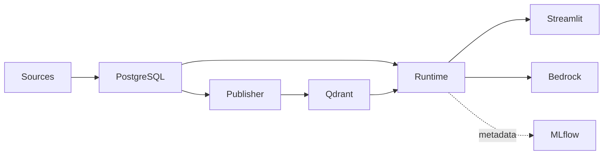

# Project learning guide

This guide follows the code that exists in the repository. It is intended for a new engineer or an
interviewer who wants to understand the design without starting from generic RAG theory.

## A. Big-picture responsibilities

| Component | Responsibility | Deliberately does not do |
|---|---|---|
| PostgreSQL lineage | Stable source identity, immutable versions/chunks, ingestion history, index generations, memberships, ACTIVE state | Vector similarity search |
| Qdrant | Dense and sparse vectors plus the exact payload served by one immutable generation | Decide which generation is ACTIVE |
| Managed runtime | Resolve ACTIVE once, validate it, load its BM25 state, and serve one pinned generation | Re-read ACTIVE for every question |
| Retrieval service | Dense search, sparse search, RRF, reranking, ACL validation, and PII policy | Generate prose |
| Bedrock provider | Invoke the configured Converse model and return provider metadata | Choose retrieval access rights |
| MLflow | Operator request traces and evaluation experiments | Serving truth or lineage truth |
| Streamlit showcase | Anonymous PUBLIC-only presentation boundary | Accept principals, groups, or PII `ALLOW` |
| Operations dashboard | Read-only private operational view | Public serving or lifecycle mutation |

Start with [factory.py](../src/consumer_finance_rag/factory.py), which is the composition root, and
[models.py](../src/consumer_finance_rag/lineage/models.py), which defines the persisted control
plane.



## B. One source document: ingestion to ACTIVE

Use the fixture source `cfpb-credit-report-errors` as a concrete example.

1. `scripts/ingest_incremental.py:assemble_snapshot()` calls
   `corpus.load_corpus_snapshot()` and produces normalized `Document` objects.
2. `LineagePlanningService.plan_snapshot()` in
   [lineage/service.py](../src/consumer_finance_rag/lineage/service.py) compares the current
   `source_key`, content hash, metadata hash, and prior ACTIVE version.
3. `LineageApplyService.apply_plan()` starts an `ingestion_runs` row, then persists or reuses the
   stable `documents` row and creates a new immutable `document_versions` row only when content or
   governed metadata changed.
4. The same apply path persists deterministic `chunks` and `document_version_pii` derivations.
5. `ChunkMaterializationService.materialize_active_manifest()` in
   [chunk_materialization.py](../src/consumer_finance_rag/lineage/chunk_materialization.py)
   reconstructs and verifies the complete active corpus.
6. `ManagedIndexService.publish()` in
   [indexing.py](../src/consumer_finance_rag/lineage/indexing.py) allocates a BUILDING generation,
   plans BM25 and dense reuse, creates a new Qdrant collection, validates it, writes memberships,
   marks it READY, and transactionally switches ACTIVE.

The key publication skeleton is:

```python
bm25_plan = plan_bm25_generation(manifest, desired.configuration, previous_bm25)
dense_plan = DenseGenerationPlanner(...).plan(manifest, embedding_fingerprint, previous_dense)
prepared = prepare_managed_generation(manifest, dense_plan, bm25_plan, identity)
target_store.create_generation_collection(candidate.collection)
target_store.upsert_points(candidate.collection, prepared.points)
target_store.validate_generation_collection(candidate.collection, prepared.points)
```

The full implementation is in
[ManagedIndexService.publish()](../src/consumer_finance_rag/lineage/indexing.py). A failed build
never replaces the current ACTIVE generation.

## C. One question: Streamlit to cited Bedrock answer

For `How can I dispute an error on my credit report?`:

1. [app/streamlit_app.py](../app/streamlit_app.py) calls `PublicRAGService.answer()`.
2. `normalize_public_question()` enforces the character bound.
3. `PublicInferenceGate.admit()` enforces the process-wide kill switch, request window, and
   concurrent Bedrock limit.
4. The deterministic PII detector redacts visitor PII before retrieval or Bedrock.
5. `RAGPipeline.answer()` receives an empty `AccessContext`, forced `PIIHandlingPolicy.REDACT`, and
   a freshly generated request ID.
6. `HybridRetrievalService.retrieve()` passes that exact ID into its terminal telemetry event.
7. Qdrant dense and sparse searches receive the anonymous PUBLIC-only filter. Returned candidates
   are validated again before and after reranking.
8. `ContextBuilder.build()` creates `[C1]`, `[C2]`, … context sections and citation records.
9. `BedrockLLMProvider.generate()` calls Converse. Metadata-only tracing records output length and
   token counts, not the answer text.
10. `PublicRAGService` validates that all returned payloads remain PUBLIC, redacts generated output,
    and returns only the answer, safe citations, model identity, and an allowlisted trace summary.

The server-side call is intentionally not parameterized by identity:

```python
response = self._runtime.pipeline.answer(
    safe_question,
    access_context=AccessContext(),
    pii_policy=PIIHandlingPolicy.REDACT,
    request_id=request_id,
)
```

See [public_showcase.py](../src/consumer_finance_rag/public_showcase.py),
[pipeline.py](../src/consumer_finance_rag/pipeline.py), and
[retrieval.py](../src/consumer_finance_rag/retrieval.py).

## D. Exact function-call sequences

### Managed ingestion and publication

```text
scripts/ingest_incremental.py:main
  -> assemble_snapshot
  -> LineagePlanningService.plan_snapshot
  -> LineageApplyService.apply_plan                    # only with --apply

scripts/index_managed.py:main
  -> ChunkMaterializationService.materialize_active_manifest
  -> ManagedIndexService.publish                       # only with --publish
  -> plan_bm25_generation
  -> DenseGenerationPlanner.plan
  -> prepare_managed_generation
  -> ManagedQdrantStore.create_generation_collection
  -> ManagedQdrantStore.upsert_points
  -> ManagedQdrantStore.validate_generation_collection
  -> ManagedIndexService._persist_ready
  -> ManagedIndexService._activate
     -> LineageRepository.transition_index_state      # ACTIVE -> RETIRED
     -> LineageRepository.transition_index_state      # READY -> ACTIVE
```

### Public answer

```text
app/streamlit_app.py:_ask
  -> PublicRAGService.answer
  -> PublicInferenceGate.admit
  -> RAGPipeline.answer
  -> HybridRetrievalService.retrieve
  -> HybridRetrievalService.retrieve_debug
  -> QdrantHybridStore.search_dense
  -> QdrantHybridStore.search_sparse
  -> reciprocal_rank_fusion
  -> RerankerProvider.rerank
  -> HybridRetrievalService._apply_pii_policy
  -> ContextBuilder.build
  -> BedrockLLMProvider.generate
  -> RequestTelemetryCollector.pop
```

### Managed answer evaluation

```text
scripts/evaluate_managed_rag.py:main
  -> build_managed_retrieval_runtime                  # ACTIVE resolved once
  -> validate_managed_dataset_compatibility
  -> evaluate_managed_rag
     -> evaluate_managed_retrieval                    # deterministic identity metrics
     -> RAGPipeline.answer                            # only with --generate
     -> run_mlflow_judges                             # only with --with-mlflow-judges
     -> build_ragas_evaluator(...).evaluate           # only with --with-ragas
  -> write_managed_rag_report
  -> evaluation_run(existing_run_id=judge_run_id)     # only with --log-mlflow
```

The evaluator lives in
[evaluation/managed_rag.py](../src/consumer_finance_rag/evaluation/managed_rag.py). The existing
adapters remain [mlflow_genai.py](../src/consumer_finance_rag/evaluation/mlflow_genai.py) and
[ragas_adapter.py](../src/consumer_finance_rag/evaluation/ragas_adapter.py).

## E. Example PostgreSQL records and Qdrant payload

The values below illustrate the shape; UUIDs and hashes are abbreviated, not claimed live data.

```text
documents
  document_pk: 7af0…
  corpus_id: 3b12…
  source_key: cfpb-credit-report-errors
  source_id: cfpb-credit-report-errors
  state: ACTIVE

document_versions
  document_version_id: 90c1…
  document_pk: 7af0…
  version_number: 2
  content_hash: 7c6f…
  metadata_hash: 04aa…
  access_visibility: PUBLIC
  allowed_groups: []

chunks
  chunk_pk: 6d9d…
  document_version_id: 90c1…
  ordinal: 0
  chunking_fingerprint: 160b…
  chunk_hash: 7c6f…

index_states
  index_state_id: d91d…
  generation: 4
  status: ACTIVE
  qdrant_collection: consumer_finance_managed_g000004

index_state_chunks
  index_state_id: d91d…
  chunk_pk: 6d9d…
  dense_action: REUSED
  dense_source_chunk_pk: 81e2…
```

`point_preparation._current_payload()` produces the real Qdrant payload contract:

```json
{
  "document_id": "cfpb-credit-report-errors:7c6f2a7acdac76c5",
  "chunk_id": "cfpb-credit-report-errors:7c6f2a7acdac76c5:0:7c6f2a7acdac",
  "source_id": "cfpb-credit-report-errors",
  "text": "stored source chunk text",
  "index_generation": 4,
  "index_state_id": "d91dc9ef-…",
  "payload_schema_version": "managed-qdrant-payload-v3",
  "access_visibility": "PUBLIC",
  "allowed_groups": [],
  "contains_pii": false,
  "pii_types": [],
  "pii_detector_version": "deterministic-pii-v1"
}
```

PostgreSQL retains lineage and membership truth; Qdrant carries the serving payload required for
search, citations, ACL enforcement, and PII handling.

## F. ACL and PII governance

### PUBLIC example

`AccessContext()` has no principal and no groups. `build_qdrant_access_filter()` creates a filter
requiring `access_visibility == PUBLIC`. A PUBLIC candidate with `allowed_groups == []` passes the
second validation. If its text contains an email address, REDACT replaces only the matched value
with `[REDACTED:EMAIL]` after reranking and before prompt construction.

### RESTRICTED example

An operator-authenticated internal caller might have groups `{"complaints-team"}`. The filter may
then match PUBLIC payloads or RESTRICTED payloads whose `allowed_groups` intersect. The public
showcase never accepts that context: it always constructs `AccessContext()` itself. Even if Qdrant
incorrectly returned a restricted point, `_validate_authorized()` and the public boundary reject
it.

PII metadata records categories and counts, never matched values. A detector-version change creates
a new derived classification and a new serving generation; it does not invent a source version.

## G. MLflow request trace versus evaluation experiment

A **request trace** explains one execution: root RAG span, embedding, dense search, sparse search,
fusion, reranking, context construction, and Bedrock generation. The public path captures the trace
ID from the active root span itself and associates the same random request ID with retrieval
telemetry. It never calls a process-global “latest trace” API.

An **evaluation experiment** compares a controlled dataset. It records pinned generation and model
identity, aggregate metrics, stage status, and a metadata-only report. MLflow judges are executed as
one batch, and combined logging resumes that run instead of creating one run per case.

Public traces use `TraceContentPolicy.METADATA_ONLY`: question, context, and answer text are omitted.
The content-bearing policy is selected only by `scripts/evaluate_managed_rag.py` after the reviewed
PUBLIC dataset has been validated.

## H. RAGAS versus MLflow judges

| Area | MLflow GenAI | RAGAS 0.4 |
|---|---|---|
| Integration | `run_mlflow_judges()` | `Ragas043Evaluator.evaluate()` |
| Metrics | Correctness, relevance, safety, retrieval groundedness when a suitable trace exists | Faithfulness, context precision, context recall, response groundedness |
| Persistence | MLflow evaluation run and scorer results | In-memory RAGAS experiment, then safe numeric report values |
| Model selection | Explicit `bedrock:/...` judge | Same explicit Bedrock URI via LiteLLM |
| Default behavior | Not requested | Not requested |

Neither backend runs when a visitor asks a question or opens the Evaluation tab. A missing, skipped,
or failed judge remains visibly non-successful; the UI never turns it into a zero or passing score.

## I. Immutable change, reuse, and restoration examples

1. **One document text changes.** Ingestion creates a new `document_versions` row and new chunks.
   Dense vectors for identical chunks can be reused; changed chunks are embedded. Because BM25 IDF
   is corpus-wide, a corpus text change causes refitting. Publication creates generation N+1.
2. **ACL-only change.** Governed metadata changes, so a new source version is retained. Text and
   embedding fingerprint match, allowing dense reuse. Corpus text is unchanged, allowing BM25
   reuse. The new Qdrant generation carries the updated authorization payload.
3. **PII detector version changes.** `document_version_pii` receives a new derived classification;
   source lineage remains unchanged. Dense vectors and BM25 can be reused, while the new generation
   records the new detector version and PII payload.
4. **Restoration.** `ManagedGenerationRestorationService` validates a compatible RETIRED source and
   publishes a new immutable generation with `restored_from_index_state_id`. It does not reactivate
   or mutate the historical row, and already-running processes remain pinned to their old generation.

See [system-design-walkthrough.md](system-design-walkthrough.md) for the five full demonstration
scenarios and [architecture.md](architecture.md) for validation/cleanup semantics.

## J. Interview explanations

### 30 seconds

“This is a plain-Python enterprise RAG platform. PostgreSQL owns immutable document and index
lineage; Qdrant serves immutable dense-plus-BM25 generations. A managed runtime pins ACTIVE once,
then applies ACL filtering, reranking, PII redaction, citation construction, and Bedrock generation.
MLflow provides safe request traces and separate evaluation experiments. The public demo exposes
only anonymous PUBLIC retrieval through a temporary tunnel.”

### 2 minutes

Add the engineering reasons. Stable document identity is separated from immutable observations so
content and governance changes are auditable. Index publication uses new Qdrant collections and a
transactional ACTIVE switch, which prevents partial builds from becoming serving state. Dense
vectors are reused at chunk/model identity; BM25 is reused only when corpus statistics match.
Retrieval applies Qdrant pre-filtering and validates every returned payload again. PII is classified
as derived metadata and redacted after reranking. Each runtime remains pinned during its lifetime.
The public app adds a server-wide billing gate and never accepts identity claims. Evaluation keeps
deterministic retrieval metrics separate from answer-generation and LLM-judge metrics.

### 10 minutes

Walk through sections B–I using one document and one question. Show the PostgreSQL record chain,
the Qdrant payload, BUILDING→READY→ACTIVE transitions, reuse decisions, and a restoration that
creates a new generation. Then contrast a visitor request trace with a managed evaluation run.
Close with limitations: the Quick Tunnel is temporary, the limiter is process-local rather than
distributed, Bedrock and local models require live credentials/resources, and evaluation quality is
only as strong as the reviewed PUBLIC cases. Those limitations are explicit instead of being hidden
behind fabricated metrics.
