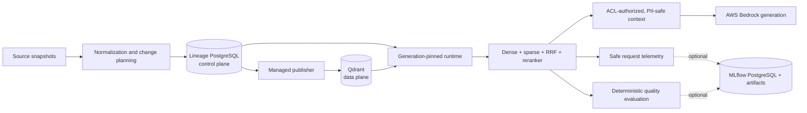
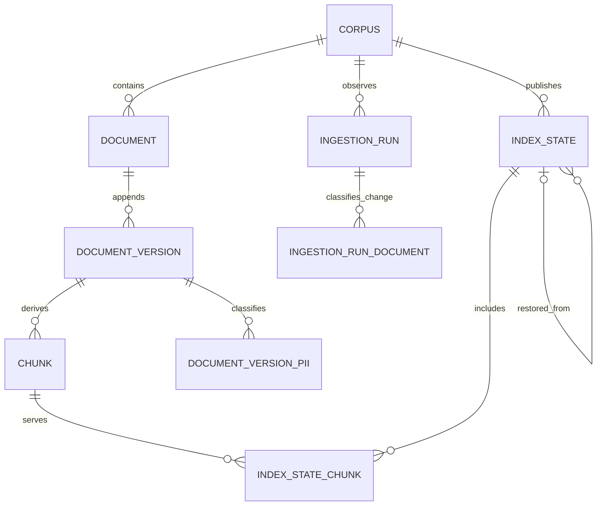
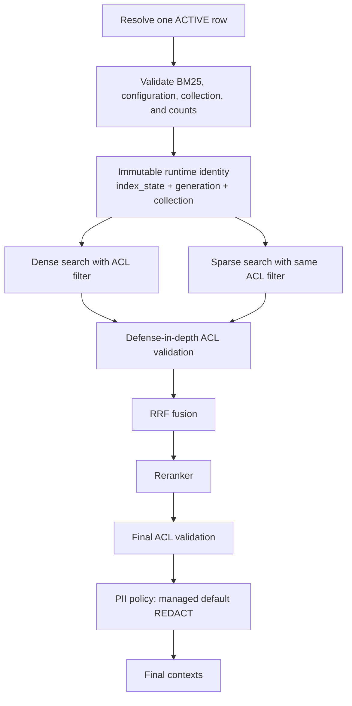
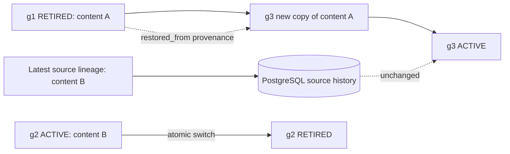

# System design walkthrough

This document explains the implemented managed RAG design and the engineering trade-offs behind
it. It complements the command-oriented [end-to-end demo](end-to-end-demo.md) and the lower-level
[architecture reference](architecture.md).

## System boundary



PostgreSQL is the control plane: it owns source lineage, immutable versions and chunks, ingestion
audit records, generation state, BM25 state and fingerprints, generation membership, dense reuse
provenance, ACL policy, PII classification identity, and restoration provenance. Qdrant is the
data plane: it owns the generation-specific dense/sparse vectors and retrieval payloads used at
query time. MLflow has a separate PostgreSQL backend and is never the source of serving truth.

This split makes activation transactional without asking Qdrant to be a metadata database. The
cost is cross-store validation: a PostgreSQL ACTIVE row is useful only when its named Qdrant
collection, configuration, points, memberships, and payload schema all agree.

## Stable identity and immutable observations



A logical document is stable by `(corpus, source_key)`. A new observation appends a
`DocumentVersion` only when normalized content or material metadata changes. The version keeps
separate content, metadata, and combined version hashes so an ACL-only metadata change is visible
without pretending the text changed.

Chunks are immutable derivations of one document version, keyed by the version, chunking
fingerprint, and ordinal. Changing chunk size or overlap creates another derivation of the same
source version. Chunk hashes and compatibility IDs support deterministic comparison, while
database UUIDs provide internal lineage identity.

PII classification is also derived rather than source identity. Its key includes the detector
version, so a detector upgrade can add a new classification without fabricating a source version
or rewriting original text.

The trade-off is more retained history and explicit joins. In return, every serving point can be
traced to the exact immutable source observation and derivation that produced it.

## Incremental computation rules

Dense embeddings and BM25 react to different kinds of change:

| Component | Dependency | Reuse decision |
| --- | --- | --- |
| Dense vector | Exact chunk text plus embedding fingerprint | Per chunk; reuse only after validating the previous ACTIVE point, payload identity, dimension, and finite vector values. |
| BM25 state | Complete ordered chunk-text corpus plus BM25/chunking configuration | Whole corpus; reuse only when corpus hash and all compatibility fields match, otherwise refit once over every active chunk. |
| Sparse point vector | Current BM25 state plus current chunk text | Re-encoded for the new generation; old sparse point values are not blindly copied during normal publication. |
| ACL/PII/citation payload | Current immutable version and derived governance facts | Rebuilt for every new point even when dense and BM25 computation is reused. |

A one-document text edit therefore refits corpus-wide BM25 but reuses dense vectors for every
unchanged exact chunk. An ACL-only edit leaves the ordered text corpus and embeddings unchanged,
so BM25 and all eligible dense vectors are reused while the new payload carries the new policy.

Reuse is conservative. Transient Qdrant transport/readiness errors receive finite backoff; an
exhausted infrastructure read aborts publication rather than being mislabeled as an intentional
embedding recomputation. Identity or integrity failures are not retried as transport problems.

## Immutable publication and ACTIVE switching

```mermaid
sequenceDiagram
    participant O as Operator
    participant PG as PostgreSQL
    participant P as ManagedIndexService
    participant Q as Qdrant

    O->>P: publish(manifest, ingestion_run)
    P->>PG: lock corpus; allocate BUILDING generation; commit
    P->>P: validate/reuse BM25 and dense vectors
    P->>Q: create immutable generation collection; upsert points
    P->>Q: validate shape and exact point count
    P->>PG: persist metadata + memberships; BUILDING -> READY; commit
    P->>PG: lock corpus; recheck baseline and target run
    P->>PG: old ACTIVE -> RETIRED; READY -> ACTIVE; one commit
```

Expensive model and Qdrant work occurs outside the short corpus lock, so the previous ACTIVE
generation remains usable during a build. The final switch is a PostgreSQL transaction that
rechecks the expected ACTIVE baseline. A failed build never modifies the serving collection in
place; it records a FAILED or, for some infrastructure activation failures, recoverable READY
candidate while preserving the previous ACTIVE generation.

Physical collection names include a monotonically allocated generation, for example
`consumer_finance_managed_g000004`. Collection collisions fail instead of deleting or recreating
data. A no-change publication validates the current generation and returns `NO_INDEX_CHANGE`
without allocating another generation.

## Generation-pinned retrieval

At runtime construction, PostgreSQL resolves exactly one ACTIVE row. The factory validates its
configuration and BM25 hashes, embedding compatibility, membership and point counts, Qdrant vector
shape, and collection name. It reconstructs the BM25 query encoder from that same ACTIVE row and
binds the service to the named Qdrant collection.



The service does not read ACTIVE again for each query. A process built for generation 3 continues
using generation 3 if generation 4 is later activated. This prevents a collection/BM25 split-brain
inside a request and makes telemetry truthful. The trade-off is deliberate restart/reconstruction
rather than automatic hot reload.

## ACL before ranking, PII after reranking

`DocumentAccessPolicy` is immutable version metadata. Managed Qdrant payload v3 carries PUBLIC or
RESTRICTED visibility and normalized allowed groups. The request supplies an already authenticated
`AccessContext`; authentication and directory lookup are outside this repository.

The same typed Qdrant filter is applied before both dense and sparse candidate search. Missing
context means public-only. Returned candidates are checked again in Python before fusion and after
reranking, so a malformed or incorrectly filtered point fails closed instead of leaking into
context.

PII has a different job and therefore a different position. Authorized original text participates
in retrieval and reranking; the selected final contexts are then processed under the request PII
policy. Managed mode defaults to `REDACT`, uses typed placeholders, and scans again after redaction.
Residual supported PII raises an error. ACL never implies permission to bypass redaction, and an
explicit `ALLOW` never bypasses ACL.

This ordering protects ranking quality while ensuring downstream generation receives only the
policy-approved representation.

## Source lineage versus restored serving state

Restoration never changes a RETIRED row back to ACTIVE. It mutation-free plans against a present,
canonical, deeply valid, current-compatible RETIRED generation, then an explicitly confirmed
operation copies its vectors, payload, memberships, BM25 state, and configuration into a new
monotonic generation.



After restoring content A, the latest source lineage may still describe content B. That is not a
contradiction: one is ingestion history, the other is current serving state. The new index row
records `restored_from_index_state_id`; no ingestion run, document version, chunk, ACL policy, or
PII classification is rewritten. Existing runtimes remain pinned to their original generation.

Restoration is intentionally stricter than historical display. Legacy RETIRED metadata can be
shown as `HISTORICAL_SCHEMA_INCOMPATIBLE`, but it is not claimed valid or made restorable. A
cleaned generation without a physical collection cannot be restored by this workflow.

## Operational telemetry versus quality metrics

These answer different questions:

| Signal | Scope | Examples | Privacy boundary |
| --- | --- | --- | --- |
| `RetrievalMetrics` | One live retrieval request | Pinned generation, stage latency, candidate counts, ACL filtering/rejections, PII policy/type counts, failure stage | No query or chunk text, matched PII, principal/group names, credentials, or exception messages. |
| `RetrievalQualityReport` | One controlled case set against one pinned generation | Recall@K, hit rate, MRR, missed case IDs, comparison deltas | Identity-only cases/results; no serialized query, context, payload, principal, or group names. |
| MLflow trace | One RAG request and its causal stages | Embedding/search/fusion/rerank/context/Bedrock spans and safe aggregate attributes | Content is replaced or omitted; token usage and safe provider/configuration identity may be retained. |
| MLflow evaluation run | One experiment | Config parameters, aggregate metrics, Git SHA, safe artifacts | Optional reporting action; judges require separate explicit opt-in. |

The default request telemetry sink is a no-op. Python structured logging needs no external service.
The optional MLflow sink appends safe aggregates to a caller-owned active run and does not create a
run per query. Deterministic managed retrieval evaluation does not call Bedrock or an LLM judge;
`--log-mlflow` only records the safe report.

## Serving health and historical audit

Operational validation treats the unique ACTIVE generation as the serving failure boundary:

- `PASS`: ACTIVE is valid and there are no historical findings.
- `PASS_WITH_WARNINGS`: ACTIVE is valid and historical legacy, incomplete FAILED builds, cleaned
  RETIRED storage, or historical corruption remains visible.
- `FAIL`: ACTIVE is missing, ambiguous, or violates current configuration, BM25, membership,
  physical count, vector shape, ACL, PII, or payload invariants.

FAILED generations may legitimately have intended counts with zero or partial memberships and
missing/partial storage. RETIRED legacy schemas are not judged by fields that did not exist, but
also are not presented as verified. The dashboard and CLI reuse this one operations result rather
than implementing a second validator.

## Interview-ready change scenarios

### A. Initial ingestion and publication

- **Input change:** A previously unregistered authoritative fixture snapshot is observed.
- **Components invoked:** normalization, change planner, `LineageApplyService`, chunk
  materialization, BM25 planner, dense planner, point preparation, `ManagedIndexService`.
- **PostgreSQL changes:** corpus and ingestion run; stable documents; version-1 rows; chunks and
  NEW classifications; then a generation row, BM25/configuration state, memberships, and ACTIVE
  status.
- **Qdrant changes:** one new immutable `g000001` collection containing payload-v3 dense and sparse
  points.
- **Reuse:** no prior generation, so BM25 is REFIT and every dense vector is COMPUTED.
- **Verify:** ingestion counts; exactly one ACTIVE; memberships equal exact point count; bounded and
  deep validation PASS; a runtime resolves generation 1.

### B. One source document changes

- **Input change:** One normalized source text changes; the other sources remain byte-for-byte
  equivalent after normalization.
- **Components invoked:** normal planning/apply and publication path.
- **PostgreSQL changes:** the stable logical document is retained; one new immutable source version
  and its chunks are added; the run records one CHANGED and the remaining UNCHANGED; generation 2
  and its memberships are added; generation 1 becomes RETIRED.
- **Qdrant changes:** a new generation-2 collection; generation 1 remains intact.
- **Reuse:** the ordered text corpus changed, so BM25 is REFIT. Exact surviving chunk vectors are
  REUSED; new/changed chunk vectors are COMPUTED.
- **Verify:** two versions for the changed document; g1 RETIRED/g2 ACTIVE; both reused and computed
  membership provenance; old runtime still returns old content and new runtime returns new content.

### C. ACL-only change

- **Input change:** Visibility or allowed groups change while normalized text is unchanged.
- **Components invoked:** metadata fingerprinting, lineage apply, normal managed publication.
- **PostgreSQL changes:** a new immutable metadata-only document version with equal `content_hash`
  and different `metadata_hash`; a new generation and memberships; old generation RETIRED.
- **Qdrant changes:** a new collection whose points contain the updated authorization payload.
- **Reuse:** ordered text is unchanged, so BM25 is REUSE; every eligible exact-text dense vector is
  REUSED; sparse values and payloads are prepared for the new generation.
- **Verify:** old/new version policy differs; old and new payload visibility differs; public,
  correct-group, and wrong-group queries return only authorized source IDs; old runtime retains its
  historical policy because it remains generation-pinned.

### D. PII detector-version change

- **Input change:** The deterministic detector implementation is assigned a new detector version;
  source text and source metadata do not change.
- **Components invoked:** chunk materialization/classification and normal publication. No ingestion
  change is fabricated.
- **PostgreSQL changes:** another `DocumentVersionPII` row per immutable source version/detector
  pair and a new generation; source `DocumentVersion` count is unchanged.
- **Qdrant changes:** a new collection with the new `pii_detector_version` and coarse PII facts.
- **Reuse:** text is unchanged, so BM25 and all eligible dense vectors are REUSED.
- **Verify:** source-version count is unchanged; both detector-version classifications exist;
  g2 payloads carry the new detector identity; metadata contains PII types/counts but not matched
  values; REDACT returns typed placeholders.

### E. Historical generation restoration

- **Input change:** An operator selects a present, valid, current-compatible RETIRED generation.
- **Components invoked:** restoration planner; only an explicit confirmed execution would invoke
  physical copy and transactional activation.
- **PostgreSQL changes:** on confirmation, one new generation and membership set with
  `restored_from_index_state_id`; previous ACTIVE becomes RETIRED. Source/ingestion/version/chunk
  lineage is unchanged.
- **Qdrant changes:** a new generation collection copied from the historical physical collection;
  neither source nor previous ACTIVE collection is overwritten.
- **Reuse:** dense and sparse vectors, payload, BM25 state, and configuration are copied; no
  embedding inference, BM25 fit, source acquisition, reranker, detector, or LLM runs.
- **Verify:** plan proposes the next monotonic generation; after a separately approved execution,
  the new row is ACTIVE with restoration provenance, original source generation remains RETIRED,
  latest source lineage still describes the newer observation, and runtimes constructed before
  the switch remain pinned.

The repository's deterministic `tests/test_phase3_end_to_end.py` exercises all five behaviors with
real orchestration boundaries, SQLite, in-memory Qdrant, and deterministic model doubles.

## Deliberate boundaries and limitations

- Fixture and evaluation profiles remain database-independent legacy paths; managed semantics do
  not leak into them.
- Authentication, identity-provider integration, runtime leases, and automatic hot reload are not
  provided. ACL consumes caller-resolved identity facts.
- The local dashboard is read-only and has no built-in authentication; bind it locally or provide
  an external control.
- Cleanup is physical Qdrant retention only. It preserves PostgreSQL history, and a cleaned
  generation is not reconstructable by the restoration workflow.
- The seed relevance set requires human review before it can support production quality claims or
  release gates.
- Offline tests do not prove live service, model-download, AWS, Bedrock, or MLflow connectivity.
